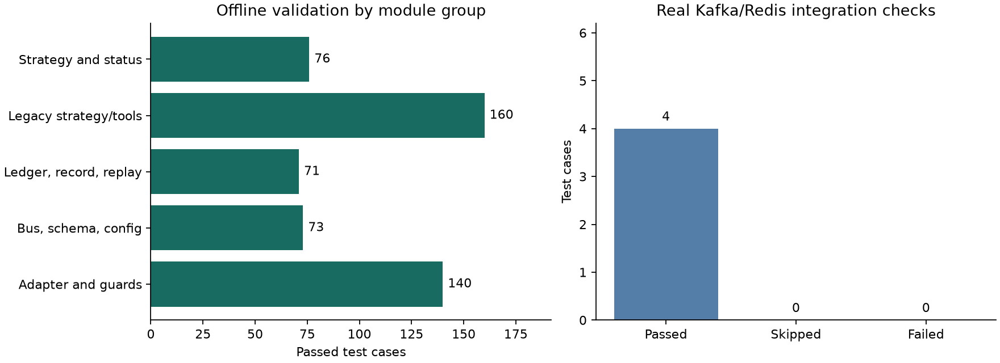

# IBKR event-driven paper trading

Coordinate a paper-trading gateway, strategy, reconciliation and recording through Kafka and Redis.

**Four real-Kafka integration tests passed in the publication check.** Offline fault and recovery tests use fake broker/state services; no real broker orders or performance benchmark were run.



## Quick start

Run from the repository root, without Docker or IB Gateway:

```bash
python3 -m venv .venv
.venv/bin/pip install -r requirements-dev.txt
make test
```

For the paper stack, copy `.env.example` to ignored `.env`, keep its loopback/paper settings, then follow [operations](docs/operations.md). `make up` starts local infrastructure; each service has a separate run target. Strategy mode defaults to dry. No market-data sample is bundled: tests generate synthetic fixtures, and the strategy fetches daily Yahoo history when used.

## Method and architecture

- Gateway adapter alone builds the real IB client; eventbot rejects non-paper ports and accounts.
- Strategy shares stock signals with the legacy backtest, freezes decisions and sends sells before buys.
- Reconciler rebuilds a fill ledger, compares broker snapshots and halts on divergence.
- Recorder saves Kafka messages to Parquet before committing offsets; replay uses a fake broker.
- Topics: `md.ticks`, `orders.intents`, `orders.events`, `fills`, `positions.snapshot`, `alerts`.
- Redis stores `kill_switch`, `intent:*`, `intent_day:*`, `orders_today:*`, `hb:*`; `pos:*` and `last:*` are caches.

## Failure handling

| Failure | Implemented response |
|---|---|
| Duplicate or ambiguous intent | Redis claim and broker-reference lookup; unresolved placement is blocked |
| Redis unavailable or stale heartbeat | Orders are blocked |
| Broker reconnect | Recheck paper account and recover broker order/fill state |
| Position mismatch | Kill switch and halt; no automatic flattening |
| Recorder crash | Durable file before offset commit; reads deduplicate by offset |

## What didn't work

This is a single-node development stack. It has no high availability or global exactly-once guarantee; the adapter outbox is memory-only and Redis coordination can lose recent writes on power failure. Paper fills do not establish live execution quality or profitability. Legacy daily tools remain for shared logic and research and have a separate explicit live opt-in; the strict paper-only guarantee applies to `eventbot/`. No IB-connected validation was performed during cleanup.

## Tests, structure and licence

[](https://github.com/VChahar1/ibkr-event-driven-trading/actions/workflows/tests.yml)

`eventbot/` contains services, `config/` contains validated settings, `tests/` covers failures, and `scripts/` contains operational controls. [Saved validation](results/validation.json) records test outcomes; [operations](docs/operations.md) details commands and limits. Code: [MIT](LICENSE).
