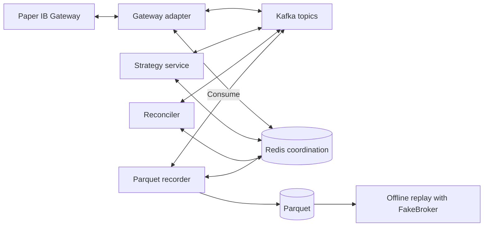

# Operating the event-driven paper stack

The commands here use `eventbot/`. They do not require a legacy daily-bot scheduler. No cleanup command connects to IB or places an order.

## Architecture

The adapter is the only eventbot entry point that constructs `IbAsyncClient`. The strategy obtains stock inputs from the shared modules and daily Yahoo history, then publishes intents. It does not connect to IB. The reconciler compares broker snapshots published by the adapter with an independently rebuilt fill ledger. The recorder subscribes to all configured topics.

## Setup and run

Install with the root README's quick start, or use `make venv`. The compatibility file `requirements-eventbot.txt` includes the full development setup. Runtime and development requirements are separately pinned.

Copy `.env.example` to `.env` and restrict its permissions. Keep `IB_HOST` on loopback and `IB_PORT` at the paper Gateway or TWS port. Leave `IB_ACCOUNT` blank only when the Gateway manages exactly one paper account; otherwise set it privately. `.env`, credentials, logs, state and collected data are ignored. Kafka and Redis defaults are loopback-only development endpoints, not secret hosts.

`make up` starts Docker Compose and creates topics. It does not start the bot services or connect to IB. Start `make run-adapter`, `make run-reconciler`, `make run-recorder` and `make run-strategy` in separate terminals when you intend to use the paper Gateway. The strategy defaults to `dry`: it logs the plan without publishing order intents. Changing to `execute` is an operational decision that can place paper orders; it is not part of the quick start.

`make status` reports current state. `make kill-on` sets the Redis kill switch; `make kill-off` clears it and should follow investigation of its reason. The configured `STOP` file is another adapter-side block. `make down` stops infrastructure while retaining volumes.

## Startup baseline

A fresh reconciler rebuilds from fill history and baselines and waits for a fresh broker snapshot. A pre-existing account position needs an explicit baseline: `make baseline` reads the latest Kafka snapshot and asks for confirmation. It does not fetch broker state itself. Do not adopt while orders are open or a snapshot is stale. Reconciliation must pass before its heartbeat can authorize orders.

## Kafka topics

| Topic | Role | Partitions | Retention |
|---|---|---:|---|
| `md.ticks` | Tick messages | 3 | 7 days |
| `orders.intents` | Requested orders | 3 | Unlimited |
| `orders.events` | Broker/order lifecycle | 3 | Unlimited |
| `fills` | Executions used by the ledger | 3 | Unlimited |
| `positions.snapshot` | Broker snapshots and reconciliation baselines | 1 | Unlimited |
| `alerts` | Fault and halt messages | 1 | 30 days |

These values are read from `config/eventbot.yaml`. The topic creator disables accidental creation through the broker configuration, requests flush-on-message for topics marked durable and verifies existing settings. A single broker and local volume do not provide replication or host-failure protection.

## Redis keys

| Key | Purpose |
|---|---|
| `kill_switch` | Halt reason; presence blocks orders |
| `intent:{id}` | `placing`, `placed`, `rejected` or `blocked` |
| `intent_day:{strategy}:{day}:{symbol}` | Prevent a resized decision from becoming another intent for that symbol/day |
| `orders_today:{date}` | Placement count for the trading day |
| `hb:{process}` | Expiring heartbeat |
| `md:watchlist` | Requested market-data subscriptions |
| `pos:{symbol}`, `last:{symbol}` | Position and price caches, not a durable ledger |

Redis failures raise a state-unavailable error and prevent order placement. Intent claims use `SET NX`. The adapter also checks broker `orderRef` history. A placement with an uncertain outcome remains `placing`; recovery adopts it only if the broker reports the order and otherwise blocks it rather than blindly retrying.

## Faults and recovery

Kafka offsets are committed after processing. Redelivery is expected; identifiers and ledger execution IDs support deduplication. The adapter queues failed publications in memory and flushes them later, so a process crash can lose that queue. Broker history and reconciliation are safeguards, not a global exactly-once transaction.

The reconciler waits for recent fills to settle, checks snapshot freshness, and sets the kill switch and exits on divergence. It does not liquidate positions. Missing reconciler or market-data heartbeats block new orders.

The recorder writes a temporary Parquet file, fsyncs it, renames it and fsyncs its directory before committing the corresponding offsets. A crash can create duplicate recorded ranges; `load_session` deduplicates by topic, partition and offset. Invalid payloads are recorded separately for inspection.

Redis uses append-only persistence with periodic fsync and no eviction in the provided Compose setup. Recent coordination writes can be lost on power failure. Test a recovery plan before relying on this stack.

## Tests and replay

`make test` runs the default offline suite using synthetic fixtures, FakeBroker, an in-memory bus and fake Redis. It neither downloads market history nor connects to IB. The private-account-digits regression test skips when a real `.env` is absent; publication separately compared the candidate with the local private identifier without disclosing it.

`make test-integration` runs tests marked `integration` against Kafka/Redis. The Redis integration fixture flushes database 15: use isolated test infrastructure, never a shared service. `make test-ib` is a separate read-only paper-Gateway suite; it replaces placement/cancellation methods with forbidden stand-ins. Those IB tests were not run for publication.

`make replay` replays the configured recording directory and returns a nonzero status if it is empty. Use `python -m eventbot.replay --help` to select a directory or date. Replay uses private in-memory services and FakeBroker, never a real IB client. Its timing measures that local code path, not Kafka throughput.

No throughput, latency, fill-quality or trading-return number has been validated for the event-driven system. The legacy research scripts and saved audit reports concern different experiments and are not eventbot performance evidence.
